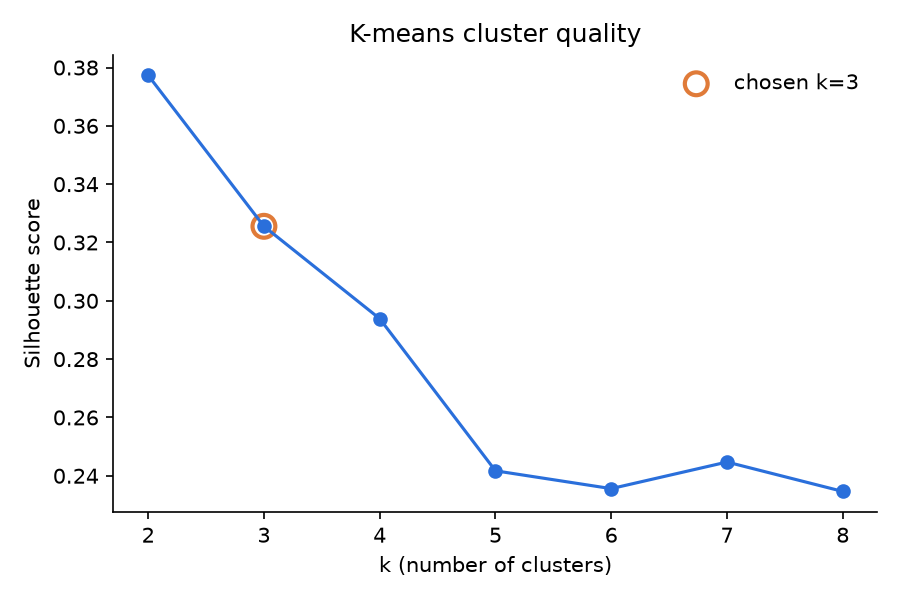
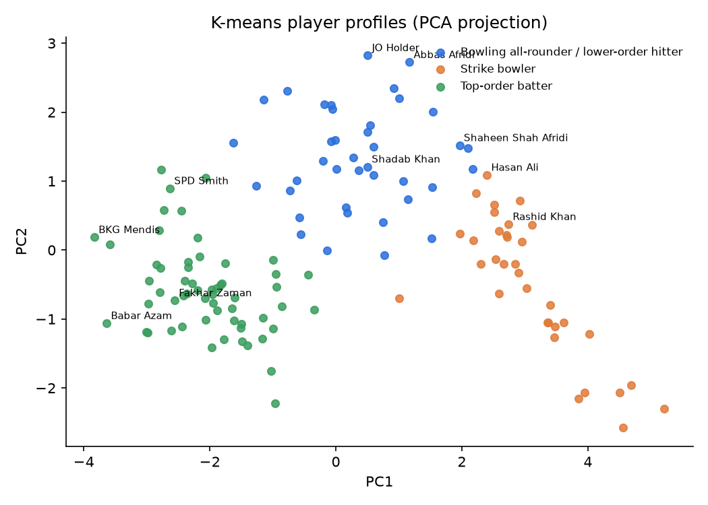
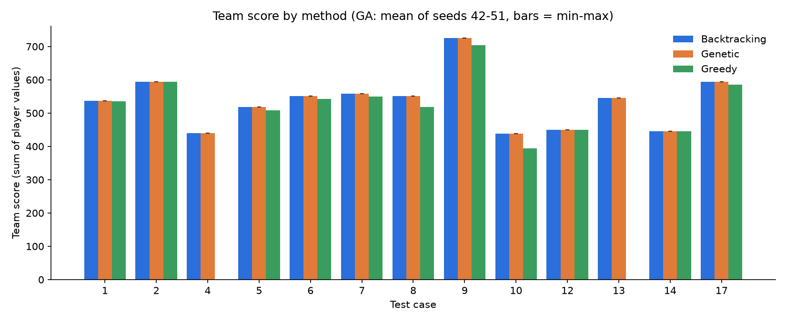
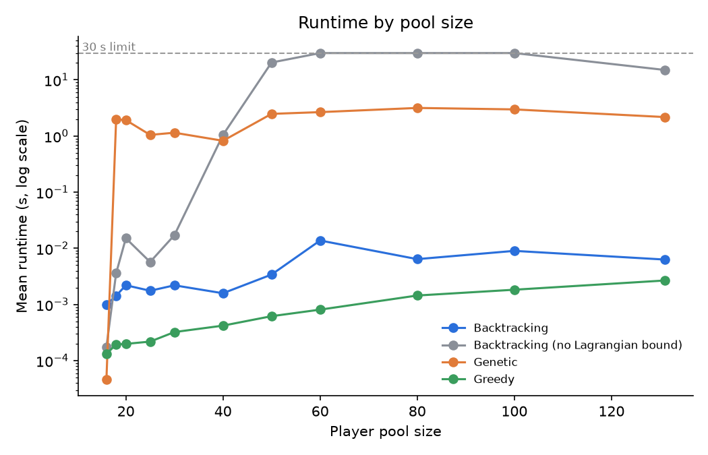
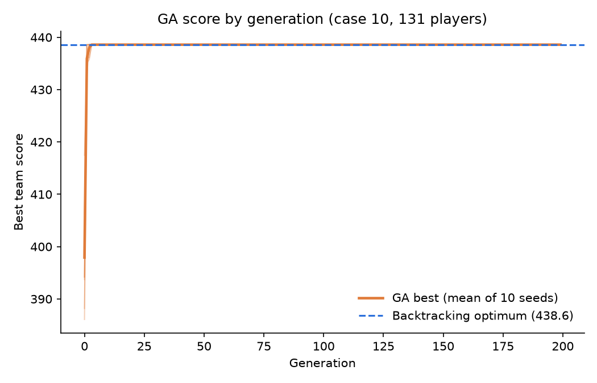

# PSL Cricket Analytics and Fantasy Team Selector: Project Report

**Course:** AL-2002 Artificial Intelligence (Lab), Fall 2026, FAST-NUCES Karachi
**Idea:** #21, Part B (Applied / Data)
**Group:** Mahad Awan (24K-3014, leader), Muhammad Basim Iftikhar (24K-3044), Huzaifa Masood (24K-3049), all in Section A

## 1. Summary

We built a Python application that turns Cricsheet's public PSL ball-by-ball data into a scored player
pool and then picks a fantasy XI under a budget and team-composition rules. K-means groups players into
playing-style profiles. Three selectors are compared on the same 20 player pools and budgets: CSP
backtracking with branch-and-bound, a genetic algorithm, and a greedy baseline. A Streamlit dashboard
shows player statistics, profiles, the selected XI and the experiment results.

**Headline results:**

* **Backtracking is exact.** It proved the optimum on every feasible case in at most 14 ms. Without the
  budget-aware bound, the same search timed out at 30 s on 5 cases.
* **The GA matched the optimum** on all 130 runs (13 feasible cases × seeds 42–51).
* **Greedy** returned no XI on 2 of the 13 feasible cases. When it did return one, it averaged 2.3% below
  the optimum, and 10% below at worst.
* **All methods correctly reported "no valid XI"** on the 7 infeasible cases.

## 2. Problem formulation

### 2.1 PEAS

| Component | Description |
|---|---|
| Performance | High total team value, a valid composition, low runtime |
| Environment | Historical PSL player pool (2022/23–2026), simulated credits, selection rules |
| Actuators | Select, remove or replace players; return an XI or report that none exists |
| Sensors | Player statistics, roles, overseas status, credits, budget, current team counts |

The environment is fully observable, deterministic, static, discrete and single-agent. The agent is a
utility-based agent.

### 2.2 Representation

* **Variables:** x_i ∈ {0,1} for each of the n players in the pool.
* **Hard constraints:**
  * Σx_i = 11
  * Σ credits_i · x_i ≤ budget
  * exactly 1 WK, 3–5 BAT, 1–3 AR and 3–5 BOWL
  * at most 4 overseas players
* **Utility:** U = Σ value_i · x_i. Only feasible XIs are accepted.
* **States** (used by backtracking): a partial team (selected players, cost, role counts, overseas count)
  plus the set of undecided players. The initial state is the empty team. A goal state is any valid XI,
  and the optimal goal is the valid XI with maximum U.

All rules are parameters of `SelectionProblem` and can be changed from the dashboard.

## 3. Data

| Item | Value |
|---|---|
| Source | Cricsheet `psl_json.zip` (PSL) and `t20s_male_json.zip` (nationality only) |
| Seasons | 2022/23, 2023/24, 2025, 2026 (PSL 8–11) |
| Matches | 143 |
| Players seen / eligible (≥ 8 matches) | 268 / 131 |
| Eligible by role | 12 WK, 48 BAT, 17 AR, 54 BOWL |
| Overseas | 55 |

**Cleaning and aggregation** (`cricsheet.py`, `dataset.py`):

* Players are keyed by Cricsheet registry id, so different spellings of a name merge into one player.
* Super overs are excluded.
* Wides do not count as balls faced. Byes and leg-byes do not count against the bowler. Bowlers are not
  credited with run-outs or retirements.
* Maidens are counted per over and per bowler.
* A player who made a stumping is recorded as having kept wicket in that match.

**Metadata** (`player_metadata.csv`): every role and overseas flag comes with its evidence.

* **Role rules:**
  * **WK:** at least one stumping and fewer than 0.5 overs per match.
  * **BAT:** fewer than 1 over per match.
  * **AR:** at least 1 over per match and at least 7 balls faced per match.
  * **BOWL:** everyone else.
* **Overseas** means the player played T20Is for a country other than Pakistan. Cricsheet's T20I archive
  has no Afghanistan matches, so five players are corrected in `manual_overrides.csv`: Rashid Khan, Gurbaz,
  Nabi, Naveen-ul-Haq, and the uncapped Kohler-Cadmore.

**Fantasy points** follow a documented Dream11-like T20 scheme:

* **Batting:** 1 per run, +1 per four, +2 per six, bonuses at 30, 50 and 100, −2 for a duck, and
  strike-rate bonuses when 10 or more balls are faced.
* **Bowling:** 25 per wicket, +8 for bowled or lbw, haul bonuses, +12 per maiden, and economy bonuses when
  2 or more overs are bowled.
* **Fielding:** 8 per catch, 12 per stumping, 6 per run-out involvement.
* **Appearance:** +4 for playing.

**Value (utility per player):**

1. Average fantasy points per match, with seasons weighted 0.6, 0.75, 0.9 and 1.0 (oldest to newest).
2. Shrink toward the role mean with strength 6 matches, so that small samples are pulled toward average.
3. Z-score within the player's role and map to 50 + 15z, clipped to [5, 100].

Normalizing within each role keeps keepers and bowlers on the same scale as batters.

**Credits (simulated):** the overall percentile of raw points per match, mapped onto 6.0–11.0 in
0.5 steps. Cost is role-agnostic and value is role-normalized, so value per credit differs between
players and the budget forces real trade-offs.

## 4. Methods

### 4.1 K-means profiles (scikit-learn)

**Features** (standardized): balls faced per match, strike rate, boundary %, batting average, overs per
match, wickets per match, economy, dot-ball %, and catches per match. Players who bowl fewer than 0.5
overs per match get a neutral economy value.

**Choosing k:** we tried k = 2–8 and took the best silhouette score with k ≥ 3 (k = 2 only separates
batters from bowlers). The chosen **k = 3** has a silhouette of **0.326**. The three profiles are:

* **Top-order batter** (58 players)
* **Bowling all-rounder / lower-order hitter** (39 players)
* **Strike bowler** (34 players)

The dashboard can re-cluster with any k. As the proposal specified, clusters are used for analysis only;
the team-rule roles are checked separately.




### 4.2 CSP backtracking with branch-and-bound (`selectors/backtracking.py`)

Each node decides one undecided player, trying include before exclude.

* **Variable ordering (MRV):** while any role is below its minimum, branch on the role with the fewest
  spare candidates (domain size minus deficit). Otherwise branch on the role whose next candidate is best.
* **Forward checking:** after every decision, prune the node if any of these is true:
  * a role maximum or the overseas cap is exceeded;
  * a role can no longer reach its minimum;
  * there are too few players left to fill 11 slots;
  * the cheapest completion that satisfies role minima exceeds the remaining budget.
* **Bound:** a Lagrangian relaxation of the budget. For any λ ≥ 0:

  best completion ≤ λ · budget_left + max_S Σ_{i∈S} (v_i − λ·c_i),

  where S ranges over completions that respect role limits. Sorting each role by v − λc turns the max
  into a prefix sum. λ is chosen once at the root, by grid and ternary search, to make the bound as tight
  as possible. With λ = 0 this reduces to the naive bound that ignores the budget.
* **Incumbent:** the greedy solution seeds the incumbent, and a 30 s limit returns the best XI found so far.

**Correctness:** tests compare backtracking against brute-force enumeration on 30 random small instances
(10 pools × 3 budgets), with and without the bound and with no pruning at all.

### 4.3 Genetic algorithm (`selectors/genetic.py`)

| Component | Setting |
|---|---|
| Chromosome | Set of 11 distinct player indices |
| Initialization | Randomized constructive: random player order, a player is kept only if forward checking says the XI can still be completed |
| Selection | Tournament, k = 3 |
| Crossover (p = 0.9) | Keep players common to both parents; fill randomly from the rest of the union |
| Mutation (0.10 per gene) | Swap with an unselected player (same role with probability 0.7) |
| Repair | Fix role maxima, then role minima, size, overseas (swap to a local of the same role), and budget (cheaper same-role swap with the smallest value loss per credit saved) |
| Fitness | Utility, minus 1000 per violated constraint, so invalid teams are never returned |
| Elitism | 2 |
| Defaults | Population 100, 200 generations, seed 42 (experiments use 42–51) |

### 4.4 Greedy baseline (`selectors/greedy.py`)

Players are sorted by value per credit, and each one is added if the partial team can still be completed
(using the same forward check). Greedy never backtracks, so it can get stuck even when a valid XI exists.

### 4.5 Class design

The class design follows the proposal:

* `Player`, `PlayerDataset` and `SelectionProblem` hold the data and the rules.
* `TeamSelector` is the abstract base class. Its `select_team()` is overridden by `BacktrackingSelector`,
  `GeneticSelector` and `GreedySelector`.
* `ExperimentRunner` runs the comparisons.

## 5. Evaluation

**Protocol:**

* **Test cases:** 20, generated with seed 42.
  * 18 are stratified random pools of 16–131 players, each guaranteed at least 2 WK, 5 BAT, 2 AR and
    5 BOWL. Budgets are drawn from {75, 80, …, 100}.
  * 2 are designed to be infeasible: a pool with no wicketkeeper, and a budget 1 credit below the cost of
    the 11 cheapest players.
  * Five of the random pools also have no valid XI, because a 75–80 budget is too tight for that pool.
    That gives **13 feasible** and **7 infeasible** cases.
* **Runs:** GA with seeds 42–51 on every case. Each run has a 30 s limit.
* **Exact checks:** pools of 20 or fewer players are also solved by brute-force enumeration.
* **Ablation:** backtracking without the Lagrangian bound.

| Method | Runs | Valid XI on feasible cases | Correct "no XI" on infeasible | Mean gap to optimum | Max gap | Hit optimum | Mean / max runtime | Timeouts |
|---|---|---|---|---|---|---|---|---|
| Backtracking | 20 | 100% | 100% | 0.00% | 0.00% | 100% | 0.004 s / 0.014 s | 0 |
| Genetic (10 seeds) | 200 | 100% | 100% | 0.00% | 0.00% | 100% | 1.64 s / 4.39 s | 0 |
| Greedy | 20 | 84.6% (11/13) | 100% | 2.31% | 10.0% | 27% (3/11) | 0.0007 s / 0.003 s | 0 |
| Backtracking, no Lagrangian bound | 20 | 100%* | 100% | 1.18% | 9.43% | 77% | 8.2 s / 30.0 s | 5 |

\* The ablation returns its best XI so far when it times out, so its XIs are valid but not always optimal.

Brute force agreed with backtracking on all 4 feasible small cases (cases 1, 2, 12 and 13).





**Discussion:**

* **The budget-aware bound is what makes exact search practical.** With the naive bound that ignores
  the budget, backtracking reaches the 30 s limit on every pool of 60 or more players. The budget is the
  binding constraint, so a bound that ignores it prunes almost nothing. The Lagrangian bound brings the
  same searches down to at most about 2,000 nodes and 14 ms. On the full 131-player pool at budget 100 it
  visits 233 nodes, against about 4.9 million nodes (and a timeout) without it.
* **The GA is reliable but much slower than exact search here.** It reached the optimum after a mean of
  4.4 generations; the slowest seed needed 50 (see the convergence chart). Its constructive initialization and
  budget-aware repair already push individuals close to optimal teams. With 131 players, the problem is
  small enough that exact search is the better tool. The GA would earn its keep on larger pools or on
  objectives without a cheap bound, such as non-additive team synergy.
* **Greedy is fast but myopic.** It does well when the budget is loose. When the budget is tight it falls
  behind: case 10 at budget 75 scored 10% below the optimum. Because it never backtracks, it also failed
  on cases 4 and 13 even though valid XIs existed.
* **Infeasible cases need no search.** On all 7 infeasible cases, forward checking proves there is no
  valid XI at the root node (1 node visited).

**Default rules (full pool, budget 100):** the optimal XI scores 739.5. It contains:

* **Stars:** Babar Azam, Shadab Khan, Holder, Shaheen Shah Afridi, Rashid Khan, Hasan Ali.
* **Low-cost fillers:** Sarfraz Ahmed (WK), Muhammad Naeem, Rajapaksa, Omair Yousuf, Miller.

## 6. Limitations

* Roles and nationality come from data rules plus overrides. They are not an official squad list.
* Credits are simulated.
* Values describe past performance only and make no prediction about future matches.
* The utility is additive, so it ignores batting-order balance and venue effects.
* The proposal deliberately left out live data, betting, paid APIs and deep learning.

## 7. Reproducing

```bash
pip install -r requirements.txt
python scripts/prepare_data.py
python -m pytest
python scripts/run_experiments.py
streamlit run app.py
```

Data: Cricsheet (https://cricsheet.org), used under its licence with attribution.
