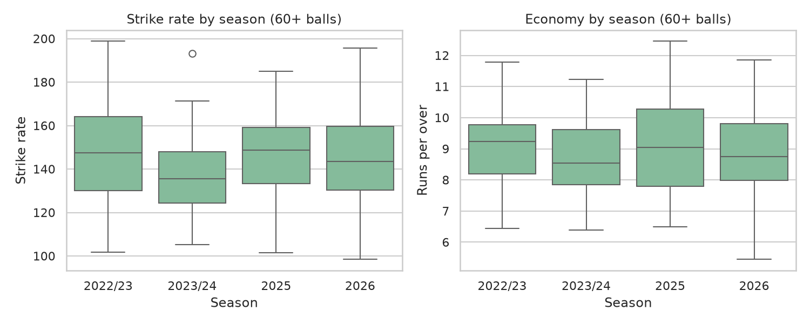
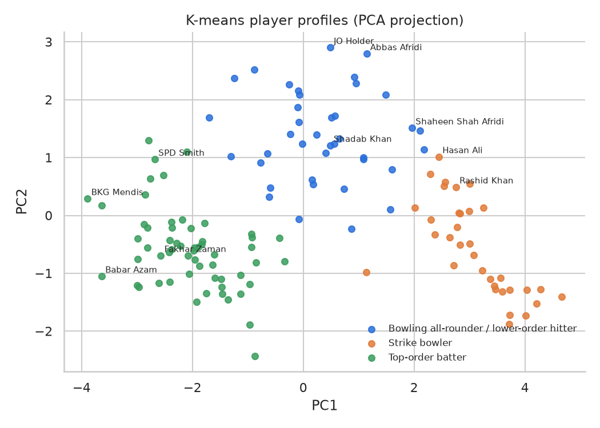
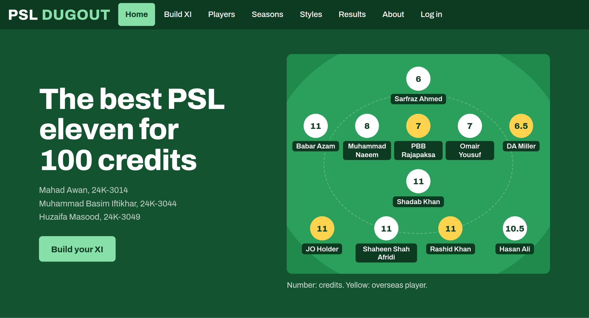
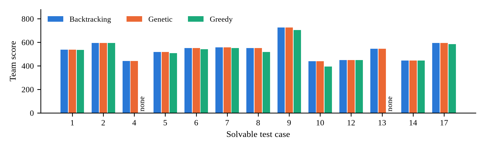
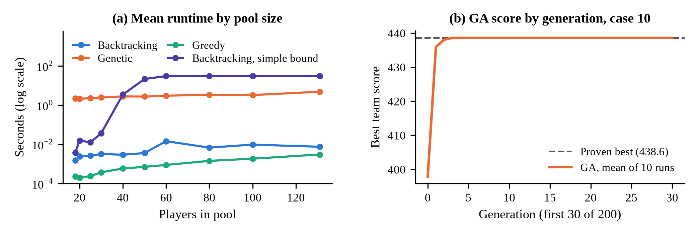

# PROJECT REPORT

Semester Lab Project | AL-2002 Artificial Intelligence | Fall 2026

| | |
|---|---|
| **Project title** | PSL Cricket Analytics and Fantasy Team Selector (PSL Dugout) |
| **Idea / category** | Idea #21 \| Part B - Applied / Data \| High |
| **Group (Section A)** | Mahad Awan, 24K-3014 (leader) \| Muhammad Basim Iftikhar, 24K-3044 \| Huzaifa Masood, 24K-3049 |
| **GitHub** | https://github.com/mahad-awan257/psl_analyzer_ai_project |
| **Date of submission** | To be filled |

## 1. Introduction

Picking a strong fantasy XI is hard when a budget and team rules must both be met. Choosing only famous players gives a team that is too expensive or unbalanced. This project scores Pakistan Super League (PSL) players from past records and searches for the best XI that fits the rules.

K-means groups players by playing style. Three methods then select a team from the same data: constraint satisfaction (CSP) backtracking with branch and bound, a genetic algorithm (GA), and a greedy baseline. They are compared on 20 seeded test cases for team score, validity and runtime. A Streamlit website, PSL Dugout, shows the players, the selected XI and the results.

**Main results.** Backtracking proved the best XI on all 13 solvable cases in at most 14.3 ms. The GA found the same score in all 130 runs but took 2.74 s on average. Greedy took under 1 ms on average, found a team in 11 of the 13 cases and the best team in 3. All methods reported no team on the 7 unsolvable cases.

## 2. Problem Formulation

### 2.1 PEAS description

**Table 1. PEAS description**

| Component | Description |
|---|---|
| Performance measure | High total team value, valid composition, low runtime |
| Environment | PSL player pool (2022/23 to 2026), simulated credits, selection rules |
| Actuators | Select, remove or replace players; return an XI or report that none exists |
| Sensors | Player statistics, roles, overseas status, credits, budget, current team counts |

### 2.2 Environment and agent type

The environment is fully observable (all player data is known), deterministic (a choice has one outcome), static (data does not change during search), discrete (players are chosen or not) and single-agent. The agent is **utility-based**: it prefers the valid team with the highest total value.

### 2.3 Variables, domains, constraints and utility

**Table 2. CSP formulation with the default rules**

| Element | Definition |
|---|---|
| Variables | x_i for each player i in the pool |
| Domains | {0, 1}: leave out or select |
| Size | The sum of x_i is 11 |
| Budget | The sum of credits_i × x_i is at most 100 |
| Roles | Exactly 1 wicketkeeper; 3 to 5 batters; 1 to 3 all-rounders; 3 to 5 bowlers |
| Overseas | At most 4 overseas players |
| Utility | Maximise the sum of value_i × x_i over valid teams |
| State / initial state | Selected players, cost, role and overseas counts, undecided players / the empty team |

The budget, role and overseas limits can be changed on the website. All rules are parameters of the SelectionProblem class.

## 3. Data and Exploratory Analysis

### 3.1 Source and preparation

Ball-by-ball PSL data comes from Cricsheet [1]. The last four seasons in the archive (2022/23, 2023/24, 2025, 2026) give 143 matches and 268 players. The **131 players** with at least 8 matches are eligible: 12 wicketkeepers, 48 batters, 17 all-rounders and 54 bowlers, of whom 55 are overseas. Parsing excludes super overs, does not count wides as balls faced, and does not charge byes and leg-byes to the bowler. Players are matched by Cricsheet registry id, so spelling variants merge.

Roles come from playing evidence. A player with a stumping who bowls under 0.5 overs per match is a wicketkeeper. Others are batters below 1 over per match, all-rounders with at least 1 over and 7 balls faced per match, and bowlers otherwise. Overseas status comes from T20 international records. Five players were corrected by hand: four Afghanistan players missing from that archive and one uncapped England player. The evidence for every player is stored in data/metadata/player_metadata.csv.

### 3.2 Missing values and outliers

**Table 3. Cleaning of the 499 player-season rows**

| Check | Rows |
|---|---|
| Strike rate not used (under 60 balls faced) | 310 |
| Economy not used (under 60 balls bowled) | 299 |
| Strike-rate outliers flagged (1.5 IQR rule) | 0 |
| Economy outliers flagged (1.5 IQR rule) | 0 |
| Duplicate player-season rows | 0 |

A rate from very few balls is unreliable, so it is treated as missing. After that step no rate lies outside the 1.5 IQR fences computed over all seasons together; within a single season, Figure 1 shows one high strike rate in 2023/24, which is a genuine performance and is kept. For clustering, missing rates are replaced by neutral values and each feature is capped at its 1.5 IQR fences.

### 3.3 Findings

- The league strike rate fell from 144.8 in 2022/23 to 137.3 in 2023/24, then recovered to 143.3 in 2026. Economy followed the same pattern: 9.04, 8.56 and 8.93 (Figure 1).
- Most runs by season: Mohammad Rizwan (550), Babar Azam (569), Sahibzada Farhan (449) and Babar Azam (588).
- Most wickets by season: Abbas Afridi (23), Usama Mir (24), Shaheen Shah Afridi (19) and Sufiyan Muqeem (22).
- All-rounders average the most fantasy points per match (46.7), then wicketkeepers (44.7), bowlers (42.1) and batters (40.4), so values are compared within roles.

**Figure 1. Strike rate and economy by season, for players with enough balls**

### 3.4 Player value and credits

Each match earns fantasy points: runs, boundaries, milestones and strike rate for batting; wickets, hauls, maidens and economy for bowling; catches, stumpings and run-outs for fielding. A player’s average is weighted by season (0.6, 0.75, 0.9, 1.0 from oldest to newest) and pulled toward the role mean with a strength of 6 matches. It is then standardized within the role: **value = 50 + 15z**, limited to 5 to 100. Credits are simulated: the percentile of weighted points per match over all roles is mapped to 6 to 11 in steps of 0.5. Cost ignores roles and value does not, so the budget forces real choices.

## 4. Design

**Table 4. Main classes**

| Class | Responsibility |
|---|---|
| Player | Immutable record: role, overseas flag, credits, value (encapsulation) |
| PlayerDataset | Downloads, cleans, aggregates and loads the player pool |
| SelectionProblem | The environment: rules, violations, utility and the forward check |
| TeamSelector (abstract) | Base agent: times, validates and wraps the overridden select_team() |
| BacktrackingSelector, GeneticSelector, GreedySelector | Inherit from TeamSelector and override select_team() |
| PlayerClusterer | Chooses k, fits K-means and names the profiles |
| ExperimentRunner | Builds seeded cases, runs all methods, summarises and plots |
| AccountStore | Local accounts and saved teams |

All code is in src/. The AI code (src/psl_selector) does not depend on the website (src/app.py, src/app_pages, src/ui), so it can be tested and run on its own.

## 5. Implementation of the Techniques

### 5.1 K-means clustering

Nine standardized features are clustered with scikit-learn [2]: balls faced per match, strike rate, boundary percentage, batting average, overs per match, wickets per match, economy, dot-ball percentage and catches per match. Parameters are n_init = 20 and random_state = 42. We tried k = 2 to 8. The silhouette score is highest at k = 2 (0.378), but that only separates batters from bowlers, so we use the best score from k = 3 upward: **k = 3 (0.336)** (Figure 2).

**Table 5. The three profiles (averages of player records)**

| Profile | Players | Balls / match | Strike rate | Overs / match | Wickets / match |
|---|---|---|---|---|---|
| Top-order batter | 58 | 17.1 | 143.6 | 0.1 | 0.0 |
| Bowling all-rounder / lower-order hitter | 39 | 7.2 | 155.7 | 2.6 | 0.8 |
| Strike bowler | 34 | 1.9 | 77.7 | 3.5 | 1.2 |

**Figure 2. Player profiles on two PCA components**

To check the clusters on unseen data, K-means was compared with Ward hierarchical clustering on the same split: both were fitted on 91 players (70%) and scored on the other 40 by assigning each to the nearest training centre.

**Table 6. Clustering models on the same 70/30 split (seed 42, k = 3)**

| Model | Silhouette, training | Silhouette, unseen |
|---|---|---|
| K-means | 0.352 | 0.273 |
| Ward hierarchical | 0.327 | 0.274 |

The two models are almost equal on unseen players, and both scores fall, so the groups are real but overlap. Clusters are used only for analysis. Team rules use the roles in Section 3.1, as the proposal planned.

### 5.2 CSP backtracking with branch and bound

The search [3] decides one player at a time, trying include before exclude. Players are kept in one list per role.

- **MRV:** while a role is below its minimum, branch on the role with the fewest spare candidates (candidates left minus players still needed).
- **Forward checking:** after each decision, prune when a role cannot reach its minimum, too few players remain, or the cheapest completion costs more than the budget left. Including a player that breaks a role, overseas or budget limit is never tried.
- **Bound:** for any λ ≥ 0, the remaining value is at most λ × (budget left) plus the best sum of (value − λ × credits) that respects role limits. A branch is cut if its bound cannot beat the best team so far.
- **λ** is chosen once at the root by grid and ternary search to make the bound as tight as possible. With λ = 0 it becomes the simple bound, which ignores the budget.

Why the bound is valid: any completion within budget satisfies λ × (budget left − cost) ≥ 0, so adding this term to its value never makes the value smaller. Maximising over all completions therefore never underestimates the best one, and cutting a branch cannot remove a better team. Greedy supplies the first best team, and a 30-second limit returns the best found so far.

### 5.3 Genetic algorithm

**Table 7. GA settings**

| Part | Setting |
|---|---|
| Chromosome | A set of 11 distinct players |
| Fitness | Team value minus 1000 for each broken rule |
| Initial population | 100 teams, built in random order while the forward check passes |
| Selection | Tournament of 3 |
| Crossover | Probability 0.9; keep players common to both parents, fill from the rest at random |
| Mutation | Rate 0.10 per player; swap with an unselected player, same role with probability 0.7 |
| Repair | Role limits, team size, overseas limit, then cheaper swaps until within budget |
| Elitism / generations / seeds | 2 / 200 / 42 to 51 |

### 5.4 Greedy baseline

Players are sorted by value per credit. Each is added if the forward check says a valid team is still possible. The check uses necessary conditions only and greedy never goes back, so it can get stuck when a valid team exists.

### 5.5 Website and local accounts

PSL Dugout has pages for building a team, players, seasons, playing styles and results (Figure 3). A login is required before any page is shown, and a new user can create an account in the same place. Accounts are kept in a SQLite file on the computer, which git ignores. Passwords are stored as salted scrypt hashes, and five wrong passwords lock an account for five minutes. “Stay logged in” keeps a random token in a browser cookie for 30 days, while the database keeps only its hash, so logging out, changing the password or deleting the account cancels it. This suits a local app; it is not meant for a public server.

**Figure 3. PSL Dugout home page with the best XI for 100 credits**

## 6. Experiments and Results

### 6.1 Protocol

The same 20 cases are used for every method, generated with seed 42. Eighteen are random pools of 16 to 131 players with a guaranteed core per role and budgets from 75 to 100. Two are designed to have no valid XI: a pool without a wicketkeeper, and a budget one credit below the 11 cheapest players. Five random pools also have no valid XI because their budget is too tight; all five become solvable with a larger budget. This leaves **13 solvable and 7 unsolvable** cases. The GA runs with seeds 42 to 51 on each. Pools of at most 20 players are also solved by exhaustive search. Gaps and runtimes below use solvable cases only, because unsolvable cases stop at once and would make every method look faster.

### 6.2 Comparison of methods

**Table 8. Results on the 13 solvable cases**

| Method | Runs | Team found | Best team | Mean gap | Largest gap | Mean time | Slowest |
|---|---|---|---|---|---|---|---|
| Backtracking | 13 | 100% | 100% | 0.0% | 0.0% | 0.005 s | 0.014 s |
| Genetic algorithm | 130 | 100% | 100% | 0.0% | 0.0% | 2.74 s | 4.93 s |
| Greedy | 13 | 85% | 23% | 2.3% | 10.0% | 0.001 s | 0.003 s |
| Backtracking, simple bound | 13 | 100% | 77% | 1.2% | 9.4% | 12.8 s | 30.0 s |

Gaps are measured against the proven best team and, for greedy, only over the 11 teams it found. All methods correctly returned no team on the 7 unsolvable cases; backtracking proved this at the first node each time.

**Table 9. The 13 solvable cases**

| Case | Players | Budget | Best score | Greedy | Gap | Nodes | Backtracks | Time (ms) |
|---|---|---|---|---|---|---|---|---|
| 1 | 18 | 90 | 536.7 | 535.1 | 0.3% | 84 | 38 | 1.7 |
| 2 | 20 | 100 | 594.5 | 594.5 | 0.0% | 72 | 29 | 1.6 |
| 4 | 30 | 80 | 440.5 | none | - | 233 | 66 | 3.2 |
| 5 | 40 | 85 | 518.6 | 508.8 | 1.9% | 93 | 37 | 2.9 |
| 6 | 50 | 85 | 550.6 | 542.0 | 1.6% | 33 | 14 | 2.7 |
| 7 | 60 | 85 | 557.9 | 550.3 | 1.4% | 1962 | 487 | 14.3 |
| 8 | 80 | 85 | 550.9 | 518.8 | 5.8% | 457 | 95 | 6.7 |
| 9 | 100 | 100 | 725.6 | 704.3 | 2.9% | 752 | 225 | 9.6 |
| 10 | 131 | 75 | 438.6 | 394.7 | 10.0% | 70 | 31 | 7.4 |
| 12 | 18 | 80 | 449.5 | 449.5 | 0.0% | 27 | 12 | 1.3 |
| 13 | 20 | 90 | 545.8 | none | - | 275 | 98 | 3.3 |
| 14 | 25 | 80 | 446.0 | 446.0 | 0.0% | 157 | 64 | 2.6 |
| 17 | 50 | 90 | 594.4 | 585.1 | 1.6% | 332 | 122 | 4.5 |

Nodes, backtracks and times are for backtracking. The GA score equals the best score in every run. Exhaustive search gave the same score on the four solvable cases with at most 20 players (1, 2, 12 and 13).

**Figure 4. Team score by method (none: greedy found no team)**

**Figure 5. (a) Mean runtime by pool size and (b) GA convergence on the 131-player pool**

### 6.3 Discussion

**The budget-aware bound makes exact search practical.** With the simple bound the search averaged 1.9 million nodes and hit the 30-second limit on 5 cases. With the Lagrangian bound it averaged 350 nodes and 101 backtracks.

**The GA is reliable here but slower.** It reached the best score after 4.4 generations on average and 50 at most. Its repair step and feasible starting teams do much of the work and the pools are small, so this is not a general guarantee.

**Greedy is fast but unreliable.** It fell short in 8 of the 11 cases where it found a team, most in case 10, and found none in cases 4 and 13.

### 6.4 Best XI under the default rules

For all 131 players and 100 credits, backtracking and the GA score **739.5** and greedy scores 710.2 (4.0% lower). The best XI pairs six expensive players with low-cost players in the other places.

**Table 10. Best XI (100 credits, 4 overseas, proven optimal)**

| Player | Role | Overseas | Credits | Value |
|---|---|---|---|---|
| Sarfraz Ahmed | Wicketkeeper | No | 6.0 | 32.3 |
| Babar Azam | Batter | No | 11.0 | 94.6 |
| Muhammad Naeem | Batter | No | 8.0 | 49.0 |
| PBB Rajapaksa | Batter | Yes | 7.0 | 44.1 |
| Omair Yousuf | Batter | No | 7.0 | 42.4 |
| DA Miller | Batter | Yes | 6.5 | 40.0 |
| Shadab Khan | All-rounder | No | 11.0 | 94.5 |
| JO Holder | Bowler | Yes | 11.0 | 91.5 |
| Shaheen Shah Afridi | Bowler | No | 11.0 | 87.2 |
| Rashid Khan | Bowler | Yes | 11.0 | 86.1 |
| Hasan Ali | Bowler | No | 10.5 | 77.8 |

## 7. Testing

The project has 52 automated tests (python -m pytest), all passing. Backtracking is checked against exhaustive search on 30 small problems with the Lagrangian bound, the simple bound and no bound. The forward check is tested never to reject a completable team. Other tests cover valid output, unsolvable cases, the overseas limit, GA reproducibility, data parsing, EDA cleaning, and accounts (hashing, lockout, sessions, ownership, deletion). The website was also clicked through in a browser at desktop and phone sizes.

## 8. Requirements and Where They Appear

**Table 11. Guideline requirements in the code (paths under src/psl_selector unless shown)**

| Requirement | Where |
|---|---|
| OOP, inheritance, overridden method | selectors/base.py TeamSelector.select_team(); selectors/backtracking.py, genetic.py, greedy.py |
| Seeded randomness | config.py SEED; genetic.py GeneticSelector.select_team(); experiments.py make_cases() |
| PEAS, environment, agent | Section 2; problem.py SelectionProblem; selectors/base.py TeamSelector |
| Lab 06: fitness, parameters, convergence | genetic.py fitness(), repair(); config.py GA_DEFAULTS; Figure 5 |
| Lab 07: MRV, forward checking, counts | backtracking.py choose_role(), check_and_bound(), search(); problem.py can_complete() |
| Lab 10: cleaning, grouping, findings | eda.py season_table(), iqr_outliers(), findings() |
| Lab 11: two models, unseen data, evaluation | clustering.py PlayerClusterer, compare_models() |
| Baseline | greedy.py GreedySelector |
| Experiment, 20 cases, table and charts | experiments.py ExperimentRunner; src/run_experiments.py |
| Specific exceptions, README, requirements | src/prepare_data.py; accounts.py; README.md; requirements.txt |

## 9. Limitations and Ethics

- Roles and overseas status are inferred from records, not from a verified list as first proposed, so some may be wrong.
- Credits are simulated. Values add up and ignore batting order, venue and opposition. Past records do not predict future matches.
- Fantasy selection is close to betting. The project offers no betting, odds or money features and should not be used for gambling.
- Scores rank real people from limited data and favour players with long PSL records. They describe past points, not a person’s worth.
- Nationality is used only for the overseas rule. Cricsheet data is used under its terms with attribution.
- Accounts hold a username, a password hash, login sessions and saved teams, stay on the computer and can be deleted by the user.

## 10. Member Contributions

The second column is the plan from the proposal. It does not show who wrote the code. Each member must complete the last column truthfully, matching their own commits, before submission.

**Table 12. Contribution of each member**

| Member | Planned modules (proposal) | Work actually done and understood |
|---|---|---|
| Mahad Awan, 24K-3014 | Data cleaning, EDA, scoring, K-means; coordination | To be completed by the member |
| Muhammad Basim Iftikhar, 24K-3044 | Constraints, backtracking, greedy, validation | To be completed by the member |
| Huzaifa Masood, 24K-3049 | GA, interface, experiment integration | To be completed by the member |

## 11. Use of AI Assistance and External Work

**Claude Code (Anthropic)** was used extensively. From the group’s proposal and instructions it generated the source code, including the backtracking, genetic and greedy selectors, the tests, the website, the experiment scripts and charts, and the draft of this report. The group chose the topic, the method plan and the website’s design direction. External work: match data from Cricsheet [1]; the libraries scikit-learn [2], Streamlit, pandas, NumPy, Matplotlib, seaborn, Altair and tabulate; and the Archivo font (SIL Open Font License).

## 12. Reproducing the Results

1. Install: python3 -m venv .venv, activate it, then pip install -r requirements.txt
2. Website: streamlit run src/app.py
3. All experiments: python src/run_experiments.py (fixed seeds; runtimes vary by computer)
4. Tests: python -m pytest
5. Rebuild the data (downloads from Cricsheet): python src/prepare_data.py

## 13. Conclusion

The application analyses PSL players, returns a valid XI or reports that none exists, and compares three methods on the same seeded cases. Exact search with a strong bound was both optimal and fast, the GA was equally accurate but slower, and greedy was quick but unreliable.

## 14. References

[1] Cricsheet, “PSL match data (JSON),” https://cricsheet.org/downloads/ (accessed Nov. 2026).

[2] F. Pedregosa et al., “Scikit-learn: Machine Learning in Python,” Journal of Machine Learning Research, vol. 12, pp. 2825–2830, 2011.

[3] S. Russell and P. Norvig, Artificial Intelligence: A Modern Approach, 4th ed. Pearson, 2021.

[4] Anthropic, “Claude Code,” https://claude.com/claude-code (accessed Nov. 2026).
